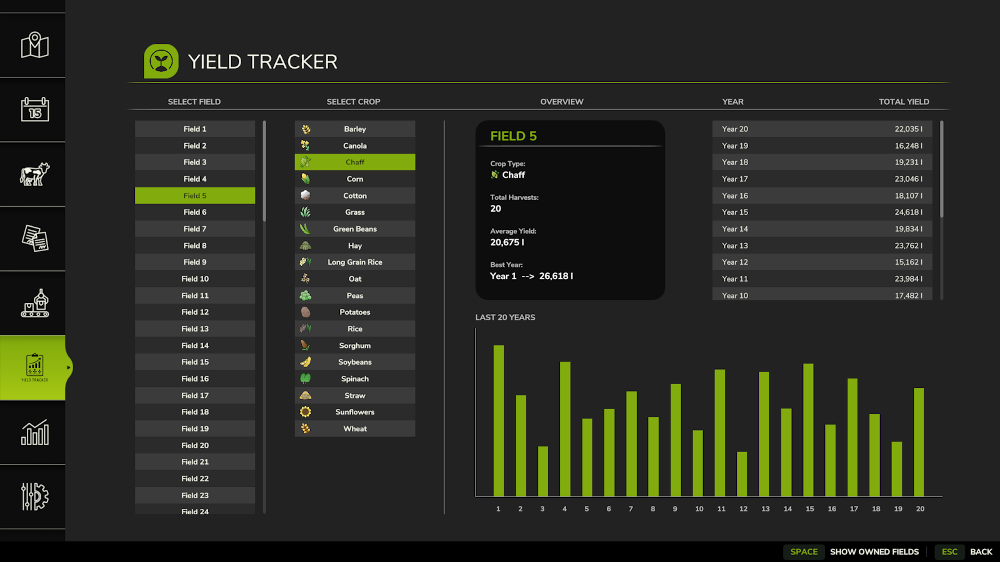
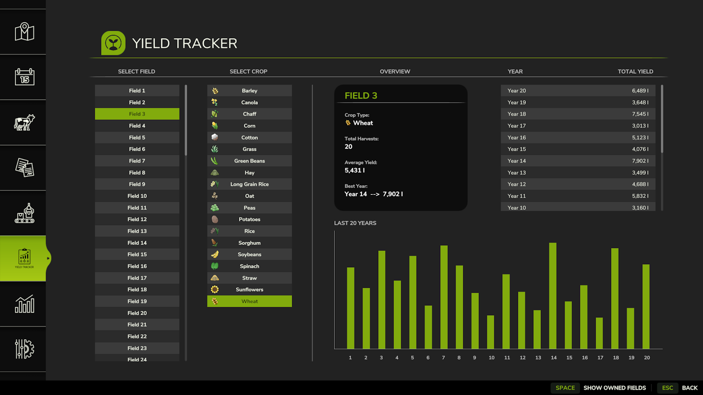

# YieldTracker

> ⚠️ **Note:** This mod currently supports **Singleplayer** mode only on **PC/Mac**.

**YieldTracker** helps you keep track of your harvests across different fields and years in Farming Simulator. It logs total yields by **crop (fill type)**, **field number**, and **year**, so you can easily monitor your farm’s performance over time.

Whether you're managing fields on your own or working with **AI workers** or **contract jobs**, YieldTracker automatically records your results for later review.

---

## 📷 Screenshots

  

---

## ✅ Features

- Tracks total yields per **field**, **crop type**, and **harvest year**
- Automatically logs results while using AI workers or doing contracts
- Simple and non-intrusive—just harvest like normal!
- Great for **long-term farm planning** and **crop rotation optimization**

---

## 📦 Supported Crops

**Every crop on any map**, including custom map and mod crops. There is no fixed crop list: a crop shows up in the menu as soon as it has been harvested.

- **Harvesters:** everything delivered by combines, forage harvesters, root crop, cotton, sugarcane, grape and olive harvesters (base game and modded)
- **Balers & loader wagons:** straw, grass, hay and any other windrow they pick up, recorded on the farmland it was picked up from

### How it works

Yield is recorded at the moment the game turns crop on the ground into liters, rather than by watching tank levels:

| Source | Hook | Amount recorded |
|---|---|---|
| Harvesters | `Combine:addCutterArea` | Liters accepted by the harvester (after rain/damage/additive effects) |
| Balers | `Baler:onEndWorkAreaProcessing` | Windrow liters picked up |
| Loader wagons | `ForageWagon:onEndWorkAreaProcessing` | Windrow liters picked up |

Yield is attributed to the farmland under the header/pickup.

Material unloaded back onto the ground (trailers, loader wagons and front loaders tipping, or bales cut open) is remembered per farmland. When a baler, loader wagon or pickup header later collects it, that amount is deducted first, so the same straw/grass/hay is never counted twice. Save data stores crops by fill type name (e.g. `WHEAT`), so it stays correct when maps or mods add or remove fill types. Yield history from older versions is converted automatically. Amounts recorded by older versions may be less accurate than new ones.

---

## 📂 Installation

1. Download the `.zip` file from the [Releases](../../releases) section.
2. Move it into your `mods` folder:
   - On Windows: `Documents\My Games\FarmingSimulator2025\mods`
3. Launch the game and activate the mod from the in-game Mods menu.

---

## 🧩 Compatibility

- ✔️ Works in **Singleplayer**
- ✔️ Compatible with **AI workers** and **contracts**

---

## 📣 Feedback & Issues

Found a bug or have a feature suggestion? Navigate to the [Issues](../../issues) section on this repository to let us know.

---

## 📜 License

This mod is open-source. You may view, modify, or contribute to it via the GitHub repository.
Redistribution is not permitted without explicit permission from the original author.
If you modify or use parts of this code, please provide proper credit.
